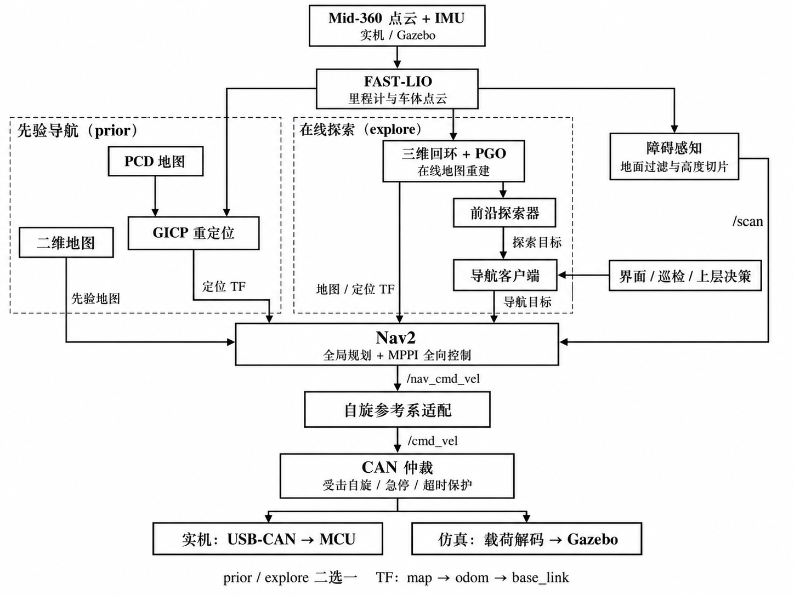

# 基于 ROS 2 和 Nav2 的哨兵自动巡检

作者：牢🐴

面向 RoboMaster 哨兵的全向底盘导航系统，支持实机与 Gazebo 仿真，提供先验地图导航、在线建图探索、巡检决策和桌面控制界面。

- **先验导航（`prior`）**：FAST-LIO 里程计 + 三维 GICP 重定位 + Nav2 / MPPI 全向控制。
- **探索导航（`explore`）**：FAST-LIO + 三维回环与 PGO 优化，在线生成二维地图并自动探索，也可指定未知目的地。
- **运动控制**：导航速度经过自旋参考系适配和 CAN 仲裁，支持受击自旋、急停与指令超时保护。

## 系统框架



`prior` 与 `explore` 二选一，分别由定位器或在线 PGO 发布 `map → odom`；FAST-LIO 发布 `odom → base_link`。

<a id="3-环境与安装依赖"></a>

## 环境与编译

使用 **Ubuntu 22.04、ROS 2 Humble、Nav2 和 Gazebo Classic**。FAST-LIO 所需的 Sophus、GTSAM、Livox-SDK2 安装见 [FASTLIO2 说明](src/rm_lio/FASTLIO2_ROS2/README.md)。

在项目根目录执行；当前开发环境使用 Conda 的 `ros2_env`：

```bash
conda activate ros2_env
source /opt/ros/humble/setup.bash
rosdep install --from-paths src --ignore-src -r -y --rosdistro humble
python -m pip install numpy scipy pillow pyyaml open3d opencv-python transforms3d PyQt5
colcon build --parallel-workers 2
source install/setup.bash
```

每个新终端先激活环境，再加载 ROS 和 `install/setup.bash`。

## 常用启动

以下命令选择一种运行。`use_ui:=true` 打开导航界面，可编辑目标、开始、暂停、取消任务或急停。

**仿真：先验地图巡检**（默认使用 `custom_room` 场景及配对地图）：

```bash
ros2 launch sim_bringup sim_nav_3d_total.launch.py \
  navigation_mode:=prior patrol_mode:=test gui:=true use_ui:=true
```

**仿真：在线建图与自动探索**：

```bash
ros2 launch sim_bringup sim_nav_3d_total.launch.py \
  navigation_mode:=explore gui:=true use_ui:=true
```

**实机：先验地图导航**，将路径和初始位姿替换为当前场地配置：

本次 `20261110_152945/obstacle_band` 地图沿用旧版 `start_prior.sh` 的启动方式，
加载该地图和建图起点位姿，并打开空目标列表的手动导航界面：

```bash
conda activate ros2_env
bash maps_output/20261110_152945/obstacle_band/start_prior.sh
# 雷达驱动已单独运行时：
bash maps_output/20261110_152945/obstacle_band/start_prior.sh start_lidar:=false
```

根目录的 `bash start_real_prior_nav.sh` 会转发到同一脚本。
二维规划和 GICP 定位分别使用 `obstacle_band/map.yaml` 和 `map.pcd`。
定位器读取同目录的 `height_filter_metadata.json`，按预计地图位姿与拟合地面
裁剪实时注册扫描，保持相对地面 0.10～1.50 m 的同一高度范围。
本地图的 RViz 配置显示 `/localizer/registration_cloud` 裁剪结果；FAST-LIO
继续使用全量雷达数据计算里程计。移动该地图时须同时保留高度裁剪记录。
动态避障同时发布 `/scan` 和只用于清除的 `/clearing_cloud`，利用真实地面、顶棚
回波在障碍高度范围内的射线段清理残留占用和膨胀圈；缺测不当作空地。
具体规则与离线验证见 [动态障碍清除](docs/dynamic_obstacle_clearing_20261110.md)。
脚本使用建图起点和原朝向作为初始位姿。其他场地可按下面的参数启动：

```bash
ros2 launch real_bringup real_nav_3d_total.launch.py \
  navigation_mode:=prior use_ui:=true patrol_mode:=formal \
  map:=/path/to/map.yaml pcd_map:=/path/to/map.pcd \
  patrol_file:=/path/to/patrol.yaml \
  initial_pose_x:=0.0 initial_pose_y:=0.0 initial_pose_yaw:=0.0
```

二维地图、PCD、初始位姿和目标点须使用同一 `map` 坐标系。`formal` 按裁判状态决策；按列表巡检时使用 `patrol_mode:=test`，并配套对应格式的巡检文件，见 [巡检配置](docs/patrol_navigation.md)。

**实机：在线建图与自动探索**：

```bash
ros2 launch real_bringup real_nav_3d_total.launch.py \
  navigation_mode:=explore use_ui:=true
```

实机完整入口包含雷达驱动与 CAN 仲裁。雷达网络配置位于 [MID360_config.json](src/livox_ros_driver2/config/MID360_config.json)，需与现场 IP 一致。

更多启动参数可在对应命令后添加 `--show-args` 查看。

<a id="mapping-only-real"></a>

## 遥控建图与保存

使用底盘原有遥控器采集实机场地地图：

```bash
ros2 launch real_bringup mapping_3d.launch.py backend:=real use_rviz:=true
```

该入口运行雷达、FAST-LIO、PGO 和 RViz。静止至少 5 秒完成 IMU 初始化后缓慢走场，并重访已采集区域以形成回环。

停车并保持建图运行，待 `/pgo/map_ready` 为 `true`，另开已加载环境的终端保存：

```bash
MAPPING_DIR="$PWD/maps_output/$(date +%Y%m%d_%H%M%S)"
mkdir -p "$MAPPING_DIR/pgo"
ros2 service call /pgo/save_maps interface/srv/SaveMaps \
  "{file_path: '$MAPPING_DIR/pgo', save_patches: true}"
```

返回 `success: true` 后，输出目录包含配对的 `map.yaml`、`map.pgm`、`map.pcd`，以及关键帧和起始位姿 `start_pose.env`。完整步骤见 [建图流程](docs/mapping_workflow.md)。

<a id="724-生成可导航且对齐的-pcd二维地图"></a>

地面被误投影为大片黑点时，可从保存的关键帧重新生成地图，另存到新目录：

```bash
ros2 run pgo static_map_filter \
  --maps-path "$MAPPING_DIR/pgo" --save-dir "$MAPPING_DIR/ground_filtered" \
  --export-map true \
  --grid-config src/rm_bringup/real_bringup/config/exploration_pgo.yaml
```

该命令与在线 PGO 共用地面拟合和二维投影逻辑，按相对地面的高度保留障碍，
地面高度归一化只影响二维投影。需要先有接近初始零高度的地面支撑，才能连续跟踪
后续高度偏移；支撑不足时短时复用模型，过期则回退到固定高度切片。

原固定高度投影工具仍可用于比较或调整投影参数：

```bash
python tools/build_prior_map.py \
  --maps-path "$MAPPING_DIR/pgo" --save-dir "$MAPPING_DIR/prior" \
  --resolution 0.05 --free-z-min -0.15 --z-min 0.10 --z-max 1.50
```

## 接口协议

### ROS 2 接口

以下为完整三维启动入口的主要接口。位置单位为 m，线速度为 m/s，角速度为 rad/s；车体坐标 x 向前、y 向左、z 向上。

| Topic | 消息类型 | 用途 |
|---|---|---|
| `/livox/lidar` | `livox_ros_driver2/msg/CustomMsg` | Mid-360 点云输入 |
| `/livox/imu` | `sensor_msgs/msg/Imu` | IMU 输入 |
| `/fastlio2/lio_odom` | `nav_msgs/msg/Odometry` | FAST-LIO 车体里程计 |
| `/navigation/odom` | `nav_msgs/msg/Odometry` | 适配到固定朝向导航参考系的里程计 |
| `/map` | `nav_msgs/msg/OccupancyGrid` | 先验或在线二维地图 |
| `/scan` | `sensor_msgs/msg/LaserScan` | 过滤、切片后的避障扫描 |
| `/goal_pose` | `rm_interfaces/msg/Goal` | `formal` 模式的目标输入 |
| `/navigation/exploration_target`、`/navigation/exploration_goal` | `rm_interfaces/msg/Goal` | 分别为未知目的地与探索器选出的可达中间点 |
| `/nav_cmd_vel`、`/cmd_vel` | `geometry_msgs/msg/Twist` | 分别为 Nav2 输出与适配后的车体速度，使用 `linear.x/y`、`angular.z` |
| `/emergency_stop` | `std_msgs/msg/Bool` | `true` 停止平移和自旋；解除后需重新开始任务 |
| `/spin_active`、`/spin_motion_permitted` | `std_msgs/msg/Bool` | 分别为受击自旋执行状态与自旋许可 |
| `/pgo/map_ready` | `std_msgs/msg/Bool` | 探索地图就绪状态；使用 Reliable + Transient Local QoS |
| `/navigation/client/status` | `rm_interfaces/msg/NavigationStatus` | 模式、任务状态、当前目标、剩余距离等 |
| `/can_twist/command_frame` | `std_msgs/msg/UInt8MultiArray` | 已编码的 8 字节 CAN 指令载荷，供监视及仿真解码 |
| `/game_para` | `rm_interfaces/msg/GamePara` | 比赛阶段、剩余时间及场地状态 |
| `/own_para` | `rm_interfaces/msg/OwnPara` | 本车血量、扣血原因等状态 |
| `/ally_para` | `rm_interfaces/msg/AllyPara` | 友方机器人状态 |

目标消息 [Goal.msg](src/rm_interfaces/msg/Goal.msg) 的字段如下，二维导航通常使用 `goal_frame_id="map"`、`goal_z=0`。单独运行 `nav_pose` 时默认输入为 `/targetPose`，完整入口将其重映射到 `/goal_pose`。

```text
string goal_frame_id
float64 goal_x
float64 goal_y
float64 goal_z
```

| 服务 / Action | 类型 | 用途 |
|---|---|---|
| `/navigate_to_pose` | `nav2_msgs/action/NavigateToPose` | Nav2 单目标导航 Action |
| `/navigation/client/configure` | `rm_interfaces/srv/ConfigurePatrol` | 配置模式和目标列表，应用后暂停；字段见 [ConfigurePatrol.srv](src/rm_interfaces/srv/ConfigurePatrol.srv) |
| `/navigation/client/start`、`/navigation/client/pause`、`/navigation/client/stop` | `std_srvs/srv/Trigger` | 分别为开始或继续、暂停、取消任务 |
| `/localizer/relocalize` | `interface/srv/Relocalize` | 指定 `pcd_path` 和初始 `x/y/z/yaw/pitch/roll`；角度单位 rad |
| `/pgo/save_maps` | `interface/srv/SaveMaps` | 指定 `file_path`、`save_patches`，保存配对地图及关键帧 |

### 底盘 CAN 协议

数据区均为 **8 字节，多字节字段使用小端序**。下发帧 **`0x120`** 的四个字段均为有符号 `int16`，顺序为右向速度、前向速度、角速度、固定控制字段：

| 字节偏移 | 编码值 | 含义 |
|---|---|---|
| 0–1 | `round(-linear.y × 500)` | 右向速度，正值向右；ROS y 正值向左 |
| 2–3 | `round(linear.x × 500)` | 前向速度，正值向前 |
| 4–5 | `round(angular.z × 500)` | 绕 z 轴角速度 |
| 6–7 | `100`（`0x0064`） | 当前固定发送的控制字段 |

例如 `linear.x=0.2`、`linear.y=-0.1`、`angular.z=0.4` 编码为 `32 00 64 00 C8 00 64 00`。完整入口默认限幅为线速度各轴 ±1 m/s、角速度 ±1 rad/s，以 100 Hz 发送；速度指令超过 0.25 s 未更新或急停时，前三个字段清零。仿真解码相同载荷并发布 `/cmd_vel_sim`。

上行帧 **`0x153`**（比赛与场地状态）：

| 字节偏移 | 含义 |
|---|---|
| 0 | bit 0–3：比赛阶段（`4` 为比赛中）；bit 4–7：扣血原因（`0` 为装甲受击） |
| 1–2 | `uint16`，阶段剩余时间，单位 s |
| 3、4 | 分别为判罚等级、违规机器人 ID |
| 5 | bit 0：补给点占领；bit 1–2：中央增益占领；bit 3/4：补给点/中央 RFID；bit 5：发射机构供电 |
| 6、7 | 分别为回血增益百分比、剩余发射量 |

上行帧 **`0x155`** 的 0–1、2–3、4–5、6–7 字节依次为本车当前血量、本车最大血量、友方 1 号血量、友方 3 号血量，均按 `uint16` 小端解析。

编码与仲裁见 [can_twist_node.cc](src/can_twist_node/src/can_twist_node.cc)，上行字段解析见 [game_state.hpp](src/can_twist_node/include/can_twist/game_state.hpp)。

## 主要目录

| 目录 | 用途 |
|---|---|
| `src/rm_bringup/` | 实机与仿真入口、Nav2 配置、探索及运动适配 |
| `src/rm_lio/FASTLIO2_ROS2/` | FAST-LIO、重定位、PGO 与 HBA 优化 |
| `src/rm_bnrobot_sim/`、`src/rm_bnrobot_nav/` | 机器人模型、仿真场景、地图与导航资源 |
| `src/rm_bnrobot_function/`、`src/nav_referee/nav_plan/` | 导航客户端、桌面界面、巡检与上层决策 |
| `src/can_twist_node/`、`src/usb_can_transport/` | 底盘 CAN 仲裁与 USB-CAN 通信 |
| `src/rm_interfaces/` | 自定义消息与服务 |
| `tools/`、`docs/` | 地图工具与专题文档 |

导航、定位、探索参数集中在 [real_bringup/config](src/rm_bringup/real_bringup/config)，巡检目标位于 [nav_plan/config/patrol](src/nav_referee/nav_plan/config/patrol)。

## 使用文档

- [导航客户端界面](docs/navigation_ui.md)
- [在线三维回环建图](docs/online_pgo_mapping_20261015.md)
- [未知目的地探索导航](docs/guided_exploration_20261015.md)
- [自旋与导航协同](docs/spin_navigation_20261014.md)
