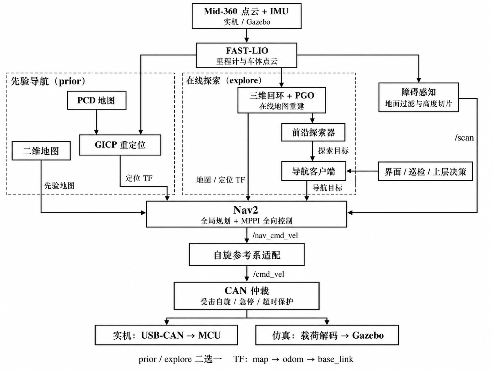

本文依据 `nav_rm_final` 当前工作区的 README、启动文件、配置和接口代码整理，面向系统使用、程序维护和后续开发。

# 1. 项目概述

本程序面向 RoboMaster 哨兵全向底盘，基于 ROS 2 Humble 和 Nav2，将激光惯性里程计、三维地图定位、在线建图、路径规划、任务决策与底盘通信组合为完整导航系统。系统提供实机和 Gazebo 仿真入口，支持桌面界面控制。

## 1.1 运行模式

| 模式 | 主要流程 | 使用场景 |
|---|---|---|
| 先验导航 `prior` | FAST-LIO → GICP 重定位 → Nav2 / MPPI → CAN | 已有配对二维地图和 PCD，需要手动导航、巡检或裁判决策 |
| 在线探索 `explore` | FAST-LIO → 三维回环与 PGO → 在线地图 → 前沿探索 / 目标探索 | 无先验地图，需要边建图边导航 |
| 遥控建图 | 雷达与 IMU → FAST-LIO → PGO → 地图保存 | 用底盘原有遥控器采集新场地地图 |

先验导航和在线探索通过启动参数 `navigation_mode` 二选一。先验模式中的 `patrol_mode:=formal` 按裁判状态选择目标，`patrol_mode:=test` 按配置列表巡检；运行中还可通过客户端配置手动目标。探索模式支持自主选择前沿，也支持指定未知目的地后逐段前往。

## 1.2 数据与坐标约定

位置以 m 表示，线速度以 m/s 表示，角度以 rad 表示，角速度以 rad/s 表示。车体坐标采用 x 向前、y 向左、z 向上。地图、定位初值和任务目标均须使用一致的坐标系。

先验定位使用的 PCD 和二维地图必须在同一原点、朝向与尺度下配对生成。探索地图的坐标参考由本次建图初始化建立。

# 2. 系统框架与程序组成

{width=15.5cm}

图 1 展示传感器、定位建图、导航任务、运动控制和实机／仿真执行的连接关系。PCD 是先验输入；实时点云同时供定位、建图和障碍感知使用。

## 2.1 处理流程

1. **感知与里程计。** 实机 Mid-360 驱动或仿真插件提供点云和 IMU，FAST-LIO 输出车体点云与激光惯性里程计。
2. **定位或建图。** `prior` 使用 GICP 对齐先验 PCD；`explore` 使用三维回环与 PGO 更新轨迹，并由优化后的关键帧重建二维地图。
3. **导航任务。** 导航客户端接收界面、巡检、上层决策或前沿探索器的目标，向 Nav2 提交导航 Action。
4. **规划与避障。** 点云经地面过滤和高度切片生成 `/scan`；Nav2 结合地图和代价地图执行全局规划与 MPPI 全向局部控制。
5. **运动执行。** 导航平移速度经自旋参考系适配后进入 CAN 仲裁，统一处理受击自旋、急停、限幅和超时，再分别交给实机 USB-CAN 或仿真载荷解码桥。

TF 主链为 `map → odom → base_link`。先验模式由 localizer 发布 `map → odom`，探索模式由在线 PGO 发布该段变换；FAST-LIO 发布 `odom → base_link`，URDF 描述传感器安装变换。导航使用适配后的 `/navigation/odom` 和 `nav_base_link`。

## 2.2 主要目录

| 目录 | 作用 |
|---|---|
| `src/rm_bringup/` | 实机与仿真启动入口、Nav2 参数、探索、地面过滤和运动适配 |
| `src/rm_lio/FASTLIO2_ROS2/` | FAST-LIO、GICP 重定位、PGO、HBA 与服务接口 |
| `src/rm_bnrobot_sim/` | 机器人模型、传感器模型、Gazebo 场景 |
| `src/rm_bnrobot_nav/` | 地图、仿真里程计参数与导航资源 |
| `src/rm_bnrobot_function/` | 导航客户端、Qt 桌面界面、地图工具 |
| `src/nav_referee/nav_plan/` | 裁判信息驱动的上层决策及巡检配置 |
| `src/can_twist_node/` | 速度编码、受击自旋及底盘命令仲裁 |
| `src/usb_can_transport/` | USB-CAN 收发与帧解析 |
| `src/rm_interfaces/` | 目标、任务状态、裁判消息与配置服务 |
| `tools/`、`docs/` | 地图转换工具和专题说明 |

导航、定位与探索参数集中在 `src/rm_bringup/real_bringup/config/`；巡检目标位于 `src/nav_referee/nav_plan/config/patrol/`。

# 3. 环境、编译与启动

## 3.1 环境准备

使用 Ubuntu 22.04、ROS 2 Humble、Nav2 和 Gazebo Classic。当前开发环境使用 Conda 的 `ros2_env`。FAST-LIO 及相关组件还需要 PCL、Eigen、Sophus、GTSAM 和 Livox-SDK2；工作区内的 FASTLIO2 说明提供了相关编译步骤。

以下命令在项目根目录执行：

```bash
conda activate ros2_env
source /opt/ros/humble/setup.bash
rosdep install --from-paths src --ignore-src -r -y --rosdistro humble
python -m pip install numpy scipy pillow pyyaml open3d \
  opencv-python transforms3d PyQt5
colcon build --parallel-workers 2
source install/setup.bash
```

每个新终端都先激活环境，再加载 `/opt/ros/humble/setup.bash` 和工作区的 `install/setup.bash`。

## 3.2 仿真先验巡检

默认使用 `custom_room` 场景及配对地图，按默认列表执行巡检，并打开 Gazebo 和导航界面：

```bash
ros2 launch sim_bringup sim_nav_3d_total.launch.py \
  navigation_mode:=prior patrol_mode:=test \
  gui:=true use_ui:=true
```

## 3.3 仿真在线探索

```bash
ros2 launch sim_bringup sim_nav_3d_total.launch.py \
  navigation_mode:=explore gui:=true use_ui:=true
```

入口启动 FAST-LIO、三维回环与 PGO、在线二维地图、Nav2、探索器、界面和仿真 CAN 桥。系统根据地图与底盘就绪状态推进导航。

## 3.4 实机先验导航

将地图、巡检文件路径及初始位姿替换为当前场地配置：

```bash
ros2 launch real_bringup real_nav_3d_total.launch.py \
  navigation_mode:=prior use_ui:=true patrol_mode:=formal \
  map:=/path/to/map.yaml pcd_map:=/path/to/map.pcd \
  patrol_file:=/path/to/patrol.yaml \
  initial_pose_x:=0.0 initial_pose_y:=0.0 initial_pose_yaw:=0.0
```

`formal` 使用正式决策格式的目标文件；按列表巡检时使用 `patrol_mode:=test` 并提供相应格式的巡检文件。所有目标点应处于当前地图的 `map` 坐标系。

## 3.5 实机在线探索

```bash
ros2 launch real_bringup real_nav_3d_total.launch.py \
  navigation_mode:=explore use_ui:=true
```

实机完整入口包含雷达驱动与 CAN 仲裁。Mid-360 网络配置位于 `src/livox_ros_driver2/config/MID360_config.json`，主机和雷达 IP 应与现场一致。各入口的全部可配置参数，可在对应启动命令后追加 `--show-args` 查看。

## 3.6 桌面操作

`use_ui:=true` 随导航启动桌面界面。界面支持实时地图和位置显示、目标编辑、列表保存、开始、暂停、取消与急停。探索链路中可选择未知目的地，客户端通过中间目标逐步推进。

向已运行的实机导航附加界面，可单独执行：

```bash
ros2 launch rm_bnrobot_function navigation_ui.launch.py \
  use_sim_time:=false
```

附加到仿真时将 `use_sim_time` 改为 `true`。界面与导航应使用相同的 ROS_DOMAIN_ID。

# 4. 遥控建图与地图管理

## 4.1 采集场地地图

实机遥控采图入口启动雷达、FAST-LIO、PGO 和 RViz，由底盘原有遥控器控制车辆：

```bash
ros2 launch real_bringup mapping_3d.launch.py \
  backend:=real use_rviz:=true
```

车辆先静止至少 5 s，等待 IMU 初始化，再低速、平稳走遍主要区域，并重访已采集区域以形成回环。地图采集完成后停车，保持建图程序和雷达继续运行。

## 4.2 保存配对地图

待 `/pgo/map_ready` 为 `true`，另开已经加载环境的终端保存：

```bash
MAPPING_DIR="$PWD/maps_output/$(date +%Y%m%d_%H%M%S)"
mkdir -p "$MAPPING_DIR/pgo"
ros2 service call /pgo/save_maps interface/srv/SaveMaps \
  "{file_path: '$MAPPING_DIR/pgo', save_patches: true}"
```

确认服务返回 `success: true` 后再结束采集。主要输出如下：

| 输出 | 用途 |
|---|---|
| `map.yaml`、`map.pgm`、`map.pcd` | 同一地图快照的二维地图和三维地图，供先验导航成对使用 |
| `start_pose.env` | 地图起始位姿，供后续初始定位配置参考 |
| `patches/`、`poses.txt`、`frame_times.txt` | 关键帧、优化轨迹与时间信息，供重建和离线优化 |
| `dynamic_filter.yaml`、`filter_metadata.yaml` | 静态地图动态点过滤配置与导出信息 |

## 4.3 重新生成导航地图

需要调整分辨率或投影高度时，使用保存的关键帧重新生成配对地图：

```bash
python tools/build_prior_map.py \
  --maps-path "$MAPPING_DIR/pgo" \
  --save-dir "$MAPPING_DIR/prior" \
  --resolution 0.05 \
  --free-z-min -0.15 --z-min 0.10 --z-max 1.50
```

工具由同一批关键帧及其最终位姿生成 PCD 和二维地图，以实际观测射线建立自由空间。HBA 可作为离线一致性优化步骤，优化后再使用对应位姿重建配对地图。采集、过滤、回环和地图管理的扩展说明保存在 `docs/mapping_workflow.md`、`docs/online_pgo_mapping_20261015.md` 等专题文件中。

# 5. 接口与通信协议

## 5.1 ROS 2 Topic

以下名称对应完整三维启动入口。速度消息使用 `linear.x`、`linear.y` 和 `angular.z`。

| Topic | 消息类型 | 作用 |
|---|---|---|
| `/livox/lidar` | `livox_ros_driver2/msg/CustomMsg` | Mid-360 点云输入 |
| `/livox/imu` | `sensor_msgs/msg/Imu` | IMU 输入 |
| `/fastlio2/lio_odom` | `nav_msgs/msg/Odometry` | FAST-LIO 车体里程计 |
| `/navigation/odom` | `nav_msgs/msg/Odometry` | 固定朝向导航参考系的里程计 |
| `/map` | `nav_msgs/msg/OccupancyGrid` | 先验或在线二维地图 |
| `/scan` | `sensor_msgs/msg/LaserScan` | 地面过滤、切片后的避障扫描 |
| `/goal_pose` | `rm_interfaces/msg/Goal` | `formal` 模式目标输入 |
| `/navigation/exploration_target` | `rm_interfaces/msg/Goal` | 未知目的地输入 |
| `/navigation/exploration_goal` | `rm_interfaces/msg/Goal` | 探索器选择的可达中间点 |
| `/nav_cmd_vel` | `geometry_msgs/msg/Twist` | Nav2 输出的导航参考系速度 |
| `/cmd_vel` | `geometry_msgs/msg/Twist` | 适配后的车体速度，送往 CAN 仲裁 |
| `/emergency_stop` | `std_msgs/msg/Bool` | `true` 停止平移和自旋 |
| `/spin_active` | `std_msgs/msg/Bool` | 仲裁器的受击自旋状态 |
| `/spin_motion_permitted` | `std_msgs/msg/Bool` | 自旋许可 |
| `/pgo/map_ready` | `std_msgs/msg/Bool` | 探索地图就绪状态 |
| `/navigation/client/status` | `rm_interfaces/msg/NavigationStatus` | 模式、任务、当前目标与剩余距离 |
| `/can_twist/command_frame` | `std_msgs/msg/UInt8MultiArray` | 8 字节 CAN 指令载荷，供监视与仿真解码 |
| `/game_para` | `rm_interfaces/msg/GamePara` | 比赛阶段、剩余时间与场地状态 |
| `/own_para` | `rm_interfaces/msg/OwnPara` | 本车血量、扣血原因等状态 |
| `/ally_para` | `rm_interfaces/msg/AllyPara` | 友方机器人状态 |
| `/cmd_vel_sim` | `geometry_msgs/msg/Twist` | 仿真桥解码得到的底盘速度 |

`/pgo/map_ready` 使用 Reliable + Transient Local QoS。`/can_twist/command_frame` 表示编码后的发送指令；物理执行状态应由底盘反馈接口另行提供。解除急停后，通过客户端重新开始任务，并由新速度指令恢复运动。

## 5.2 目标与状态消息

目标消息 `rm_interfaces/msg/Goal`：

```text
string goal_frame_id
float64 goal_x
float64 goal_y
float64 goal_z
```

二维导航通常使用 `goal_frame_id="map"`、`goal_z=0`。单独运行 `nav_pose` 时默认输入为 `/targetPose`，完整入口将其重映射到 `/goal_pose`。

`NavigationStatus` 的主要字段分组如下：

- 模式与执行状态：`mode`、`state`、`message`。
- 控制状态：`paused`、`active`、`emergency_stop`。
- 目标列表位置：`point_index`、`point_count`、`point_name`。
- 当前目标与剩余距离：`target`、`distance_remaining`。

## 5.3 服务与 Action

| 接口 | 类型 | 作用 |
|---|---|---|
| `/navigate_to_pose` | `nav2_msgs/action/NavigateToPose` | Nav2 单目标导航 Action |
| `/navigation/client/configure` | `rm_interfaces/srv/ConfigurePatrol` | 配置客户端模式和目标，应用后暂停 |
| `/navigation/client/start` | `std_srvs/srv/Trigger` | 开始或继续任务 |
| `/navigation/client/pause` | `std_srvs/srv/Trigger` | 暂停并保留当前目标 |
| `/navigation/client/stop` | `std_srvs/srv/Trigger` | 取消当前任务 |
| `/navigation/decision/configure` | `rm_interfaces/srv/ConfigurePatrol` | 更新正式决策目标和血量阈值 |
| `/localizer/relocalize` | `interface/srv/Relocalize` | 指定地图与初始位姿，触发重定位 |
| `/pgo/save_maps` | `interface/srv/SaveMaps` | 保存配对地图，可选保留关键帧 |

`ConfigurePatrol` 请求字段包括 `mode`、`frame_id`、`loop`、`wait_seconds`、`health_threshold`、`point_names` 和 `points`。客户端模式支持 `formal`、`test`、`manual`、`explore`、`explore_goal`；`points` 为 Goal 数组。`explore_goal` 使用一个 map 坐标系目的地。正式决策配置使用 recovery、occupy、attack、defend 四类目标和 `health_threshold`。

`Relocalize` 请求包含 `pcd_path`、`x/y/z` 与 `yaw/pitch/roll`，角度使用 rad。`SaveMaps` 请求包含目录 `file_path` 和布尔值 `save_patches`。上述配置及地图服务使用 `success` 和 `message` 返回处理结果。

## 5.4 CAN 下发：0x120

应用数据区为 8 字节，四个字段均为有符号 `int16`，多字节字段使用小端序。前三项依次为左向速度、前向速度和绕 z 轴角速度，第四项当前固定为 100。

| 字节偏移 | 编码 | 含义 |
|---|---|---|
| 0–1 | `round(linear.y × 500)` | 正值向左 |
| 2–3 | `round(linear.x × 500)` | 正值向前 |
| 4–5 | `round(angular.z × 500)` | 绕 z 轴角速度 |
| 6–7 | `100`，即 `0x0064` | 固定控制字段 |

例：`linear.x=0.2`、`linear.y=-0.1`、`angular.z=0.4`，编码后的字段为 `[-50, 100, 200, 100]`，对应字节为：

```text
CE FF 64 00 C8 00 64 00
```

完整入口的仲裁限幅为各平移轴 ±1 m/s、角速度 ±1 rad/s，发送定时周期为 10 ms，即 100 Hz。速度指令超过 0.25 s 未更新或急停时，前三项清零。仿真桥对相同载荷解码后发布 `/cmd_vel_sim`。

100 Hz 为 CAN 仲裁发送周期；当前 Nav2 局部控制频率为 20 Hz，配置中的平移速度上限为 0.50 m/s。规划限速与 CAN 仲裁限幅分别生效。

## 5.5 CAN 上行：0x153 与 0x155

`0x153` 为 8 字节比赛及场地状态：

| 字节偏移 | 含义 |
|---|---|
| 0 | bit 0–3 为比赛阶段；bit 4–7 为扣血原因 |
| 1–2 | `uint16` 小端，阶段剩余时间，单位 s |
| 3 | 判罚等级 |
| 4 | 违规机器人 ID |
| 5 | bit 0：补给点占领；bit 1–2：中央增益占领；bit 3：补给 RFID；bit 4：中央 RFID；bit 5：发射机构供电 |
| 6 | 回血增益百分比 |
| 7 | 剩余发射量 |

比赛阶段 0–5 分别为未开始、准备、自检、倒计时、比赛中、结算。扣血原因 `0` 表示装甲受击。中央增益占领值 0–3 分别表示空闲、己方、敌方、双方。

`0x155` 的四个字段均按 `uint16` 小端解析：

| 字节偏移 | 含义 |
|---|---|
| 0–1 | 本车当前血量 |
| 2–3 | 本车最大血量 |
| 4–5 | 友方 1 号血量 |
| 6–7 | 友方 3 号血量 |

速度编码与仲裁实现在 `src/can_twist_node/src/can_twist_node.cc`，上行字段解析实现在 `src/can_twist_node/include/can_twist/game_state.hpp`。

# 6. 开源基础与参考来源

## 6.1 采用的开源组件

当前程序在现有开源算法和框架上完成 ROS 2 集成、场景适配、任务管理与底盘接入。下表根据工作区的依赖、代码和原有说明归纳各组件的作用。

| 开源项目 | 在本程序中的作用 | 对应位置或采用方式 |
|---|---|---|
| ROS 2 Humble [1] | 节点通信、Topic、服务、Action、TF 和生命周期基础 | 各功能包与 launch 文件 |
| Nav2 / MPPI [2][3] | 全局规划、代价地图、行为树导航和全向局部控制 | Nav2 参数、导航行为树与 `Omni` 运动模型 |
| FAST-LIO / FAST-LIO2 [4] | 激光惯性里程计及直接点云配准的算法基础 | 工作区 `FASTLIO2_ROS2/fastlio2` 重构版本 |
| GTSAM [5] | 位姿图和因子图优化基础 | `pgo`、`hba` 的优化依赖 |
| PCL / GICP [6] | 点云处理与广义 ICP 配准 | `localizer` 的粗到细重定位与点云处理 |
| HBA、BALM [7][8] | 激光地图一致性与 BA 优化参考 | `hba` 离线优化组件及原项目致谢 |
| livox_ros_driver2、Livox-SDK2 [9][10] | Mid-360 设备接入与数据通信 | 实机雷达驱动和 SDK |
| Livox 激光仿真 ROS 2 移植 [11] | Gazebo Classic 中的 Livox 点云仿真 | `src/livox_laser_simulation_ros2/`，原项目来自 Livox-SDK |
| Gazebo / ros2_control [12] | 场景、机器人及传感器仿真，关节控制集成 | `rm_bnrobot_sim` 和仿真启动入口 |
| Sophus、Open3D [13][14] | 李群运算与离线点云处理 | FAST-LIO / HBA 数学依赖和地图转换工具 |

此外，工程使用 Eigen、NumPy、SciPy、Pillow、PyYAML、OpenCV、Qt / PyQt5 等数值、图像和界面工具。HBA 为可选离线流程；当前在线探索主链使用在线 PGO。工作区保留 AMCL 二维导航入口，主说明采用三维定位与建图链路。

工作区 `FASTLIO2_ROS2/README.md` 明确列出了对 FAST-LIO、BALM 和 HBA 的参考关系；本文采用其已标注的算法来源。公开上游项目的功能介绍与本程序实际使用方式分别以官方页面和工作区代码为依据。

## 6.2 参考链接

下列链接为项目或组件的官方资料，核对日期为 2026 年 10 月 31 日。

1. [ROS 2 Humble 文档](https://docs.ros.org/en/humble/index.html)
2. [Nav2 官方文档](https://docs.nav2.org/)
3. [Nav2 MPPI Controller 源码说明](https://github.com/ros-navigation/navigation2/blob/main/nav2_mppi_controller/README.md)
4. [FAST-LIO / FAST-LIO2](https://github.com/hku-mars/FAST_LIO)
5. [GTSAM](https://github.com/borglab/gtsam)
6. [PCL GeneralizedIterativeClosestPoint](https://pointclouds.org/documentation/classpcl_1_1_generalized_iterative_closest_point.html)
7. [HBA：Hierarchical LiDAR Bundle Adjustment](https://github.com/hku-mars/HBA)
8. [BALM：Bundle Adjustment for LiDAR Mapping](https://github.com/hku-mars/BALM)
9. [Livox ROS Driver 2](https://github.com/Livox-SDK/livox_ros_driver2)
10. [Livox-SDK2](https://github.com/Livox-SDK/Livox-SDK2)
11. [Livox 激光仿真 ROS 2 移植](https://github.com/LihanChen2004/livox_laser_simulation_ros2)；[Livox 原版仿真插件](https://github.com/Livox-SDK/livox_laser_simulation)
12. [gazebo_ros2_control](https://github.com/ros-controls/gazebo_ros2_control)；[ros2_control](https://github.com/ros-controls/ros2_control)
13. [Sophus](https://github.com/strasdat/Sophus)
14. [Open3D 文档](https://www.open3d.org/docs/release/)

# 7. 本导航程序的特点

## 7.1 定位、建图和导航统一组织

程序将先验导航和在线探索放在同一套启动与客户端结构中，通过 `navigation_mode` 明确选择链路。实机和仿真共用导航核心、消息定义与运动仲裁，便于场地参数迁移和功能维护。

## 7.2 三维定位与二维规划结合

先验模式利用 FAST-LIO 与三维 GICP 完成定位，Nav2 使用配对二维地图规划。探索模式以三维关键帧和位姿图优化维护轨迹，再重建二维地图；地图更新与任务执行通过就绪状态协同。

## 7.3 面向全向底盘的平移与自旋协同

MPPI 使用 Omni 运动模型。导航在固定朝向的参考系中计算平移，适配器将其转换到实际旋转车体；受击自旋由底层仲裁统一执行。该组织方式适配哨兵边移动、边自旋的控制需求，并结合车体外形与扫描信息处理通行净空。

## 7.4 区分实时避障与静态地图导出

实时扫描通过地面估计和高度切片形成障碍输入。静态地图导出利用多帧观测一致性和射线证据处理动态残留；相关过滤作用于地图构建与导出，实时避障仍保留现场障碍观测。

## 7.5 任务与执行状态明确

导航客户端统一管理正式决策、列表巡检、手动导航和探索目标，提供配置、开始、暂停、取消和状态查询。桌面界面与原客户端通过服务协作，目标编辑、文件保存和任务执行具有明确操作入口。

## 7.6 实机与仿真共享底盘载荷

同一仲裁器生成 `0x120` 载荷：实机经 USB-CAN 发送，仿真经桥接节点解码。速度坐标约定、缩放和指令超时处理在两种环境中保持一致，减少控制链路重复实现。

这些特点属于针对哨兵场景的系统集成与工程实现；FAST-LIO、GICP、MPPI、位姿图优化等基础算法的来源见第 6 章。

# 8. 未来开发规划建议

以下为结合当前结构提出的后续开发路线，按优先级安排。各阶段的量化目标应由团队结合车辆性能、场地和算力确定。

## 8.1 第一阶段：形成可复用的实机交付流程

优先建立统一的场地配置包，将地图版本、初始位姿、雷达外参、底盘几何、Nav2 参数和巡检目标集中管理。提供完整的启动、停止、建图、保存与地图切换说明，降低换场地时的人工修改量。

同时完善底盘反馈接入，逐步增加实际速度、运行模式、底盘状态及物理急停信息，使发送指令和执行反馈能够对应。协议演进保持明确的版本和字段定义。

**阶段产出：** 可复用的场地配置目录、实机操作手册、底盘反馈接口说明。

## 8.2 第二阶段：提升定位与探索的场景适应性

围绕长走廊、开阔区、重复结构和动态人群，完善定位质量度量、重定位策略和地图版本管理；细化回环确认、地图修正和任务恢复之间的状态联动。

探索器进一步综合信息增益、路径代价、净空和目标方向，减少重复覆盖；增加覆盖范围、任务进度和探索结束条件的可视化，改善大场地使用体验。

**阶段产出：** 场景化定位配置、探索策略参数集、覆盖与定位质量可视化。

## 8.3 第三阶段：增强任务决策与平台维护能力

扩展裁判驱动决策与导航任务之间的优先级、打断和恢复规则，将补给、占领、巡逻及人工接管组织为可配置任务流程。界面增加地图及任务版本选择、事件记录和运行状态导出。

通过性能分析优化点云处理、回环计算、地图重建和内存占用；建立固定数据回放与自动化回归流程，并评估向现代 Gazebo 与相应控制插件迁移的工作量。

**阶段产出：** 可配置任务策略、运行记录工具、性能分析报告及部署环境说明。

## 8.4 建议的里程碑与验收维度

| 优先级 | 里程碑 | 建议验收维度 |
|---|---|---|
| P0 | 场地配置与部署规范 | 同一配置可重复启动；地图、外参、目标和程序版本可追溯 |
| P0 | 底盘反馈与状态闭环 | 可区分发送指令与执行反馈；急停、恢复与模式切换有明确状态 |
| P1 | 定位与地图协同增强 | 统计定位恢复时间、地图对齐误差和重定位成功率 |
| P1 | 探索与动态场景能力 | 统计覆盖率、到达率、重复路径比例、最小净空和任务耗时 |
| P1 | 决策与人工接管协同 | 可复现任务打断、人工接管和恢复；目标来源及状态可解释 |
| P2 | 性能与持续维护 | 记录 CPU、内存、规划时延与长时间运行表现；支持回放和版本复现 |

建议按“场地与执行闭环 → 定位和探索能力 → 决策、性能与部署维护”的顺序推进，每个里程碑都交付代码、参数、接口说明和对应记录，再进入下一阶段。
